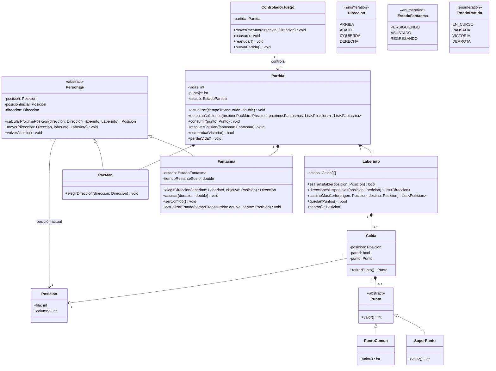

# Diagrama de clases — diez requerimientos de Pac-Man

**Fuente:** `Requerimientos TPO PacMan 1.md`, redactado por Juan. Este diagrama es una propuesta de diseño elaborada con asistencia de IA; no modifica ni reemplaza los requerimientos originales.

## Cómo cubre los requerimientos

| N.º | Responsabilidad en el diseño |
| --- | --- |
| 1 | `ControladorJuego.moverPacMan` recibe una `Direccion`; `PacMan` la elige y `Personaje.mover` la aplica. |
| 2 | `Personaje.calcularProximaPosicion` consulta `Laberinto.esTransitable` y deja al personaje en su celda actual si la siguiente es una pared. |
| 3 | Cada `Celda` transitable puede contener un `Punto`; `PuntoComun.valor()` devuelve 10 y `SuperPunto.valor()` devuelve 50. Al crear el laberinto se ubican cuatro `SuperPunto` en las esquinas. |
| 4 | `Partida` contiene exactamente cuatro `Fantasma`. En estado `PERSIGUIENDO`, cada uno usa `Laberinto.caminoMasCorto` en los cruces para acercarse a Pac-Man. |
| 5 | `Partida.consumir` asusta a los fantasmas al consumir un `SuperPunto`. En estado `ASUSTADO`, `Fantasma.elegirDireccion` elige al azar entre las disponibles hasta agotar `tiempoRestanteSusto`. |
| 6 | `Partida.resolverColision` suma 200 al comer un fantasma asustado y llama a `serComido`. El estado `REGRESANDO` lo lleva al centro; allí pasa a `PERSIGUIENDO`. |
| 7 | `Partida.detectarColisiones` identifica los fantasmas con los que Pac-Man entra en contacto. `resolverColision(fantasma)` consulta el estado del fantasma: si está asustado, aplica el requerimiento 6; si no, llama a `perderVida`, devuelve a Pac-Man a `posicionInicial` y a los fantasmas al centro. |
| 8 | `Partida` comienza con `vidas = 3` y cambia a `DERROTA` al llegar a cero. |
| 9 | `Laberinto.quedanPuntos` permite cambiar a `VICTORIA` cuando no queda ningún `Punto`. |
| 10 | `ControladorJuego` pausa, reanuda y crea una partida nueva una vez que la anterior terminó. |

**Precisiones de diseño:** se interpreta «puntos en cada celda» como puntos en las celdas transitables, porque las paredes no se pueden recorrer. La duración concreta del susto no está fijada por los requerimientos y queda como parámetro. Una celda contiene como máximo un punto, común o súper punto.

**Detección y resolución de colisiones:** `Partida.actualizar` coordina cada paso y obtiene una sola vez la dirección y la próxima posición de cada personaje. `detectarColisiones` compara las posiciones actuales y próximas para identificar tanto una llegada a la misma celda como un intercambio de posiciones; devuelve los fantasmas involucrados, sin consultar si están asustados. `resolverColision(fantasma)` consulta ese estado y aplica la consecuencia: comer al fantasma o perder una vida. Si se pierde una vida, se descartan los movimientos y las colisiones pendientes de ese paso, porque las posiciones se restablecen. En los demás casos, se aprovechan los movimientos ya calculados, respetando los cambios producidos por la resolución. Así, una elección aleatoria no se repite entre la comprobación y el movimiento.
